<div align="center">

# Grantly

### One profile. Every scholarship, explained.

A scholarship co-pilot that finds what you qualify for, explains why in plain language,<br/>
walks you through every application, and shows how much of your year is actually funded.

**[Live demo](https://aayushsinghthapa-cloud.github.io/grantly/)** · **[Source](https://github.com/aayushsinghthapa-cloud/grantly)** · Built for _THE OUTPOST_ by Frontend Arena

[](https://github.com/aayushsinghthapa-cloud/grantly/actions/workflows/deploy.yml)   

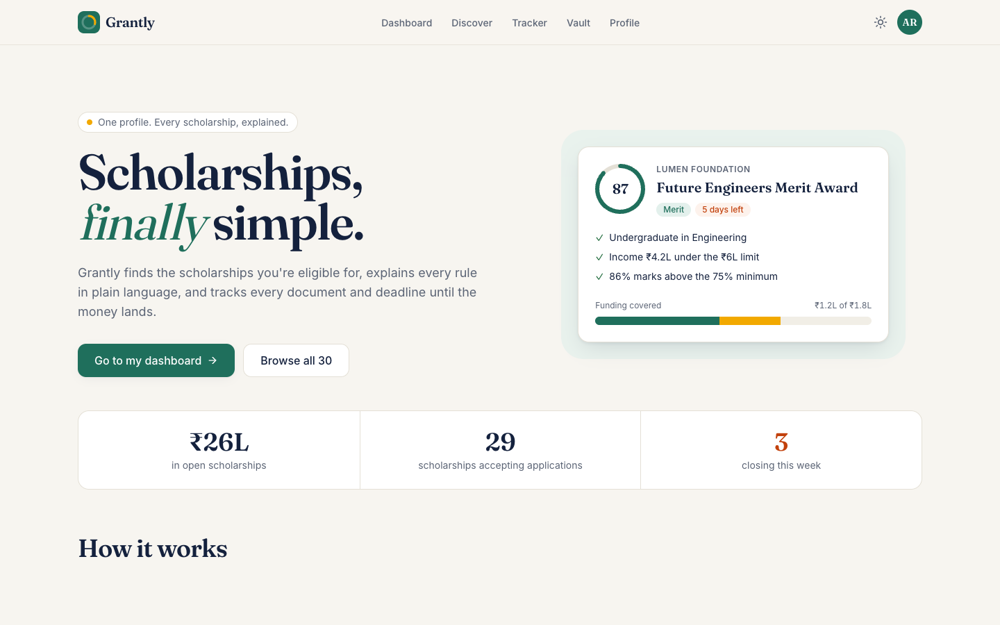

</div>

> **Judges, start here.** Open the [live demo](https://aayushsinghthapa-cloud.github.io/grantly/). Every page already shows a working sample student (Ananya), so nothing needs to be filled in first: try [Dashboard](https://aayushsinghthapa-cloud.github.io/grantly/dashboard), [Discover](https://aayushsinghthapa-cloud.github.io/grantly/discover), [a scholarship](https://aayushsinghthapa-cloud.github.io/grantly/scholarship/future-engineers-merit), [Tracker](https://aayushsinghthapa-cloud.github.io/grantly/tracker) and [Compare](https://aayushsinghthapa-cloud.github.io/grantly/compare). Press ⌘K / Ctrl+K anywhere. **Use my own details** switches to your own profile.

---

## Judging criteria → evidence

| Criterion                                   | What to look at                                                                                                                                                                                                                                                                                                                                                                                              |
| ------------------------------------------- | ------------------------------------------------------------------------------------------------------------------------------------------------------------------------------------------------------------------------------------------------------------------------------------------------------------------------------------------------------------------------------------------------------------ |
| **UI/UX & visual quality**                  | One calm design system (neutral greys, a single emerald accent, Geist, pill controls), designed light **and** dark themes, empty, loading and 404 states, and toasts for every action. The landing page is a live, scroll-choreographed tour of the real product ([design notes](#design--motion)).                                                                                                          |
| **Functionality**                           | 9 working routes and 30 scholarship pages. Fuzzy search with 7 filters and 3 sorts, match scores, compare (up to 3), interactive application roadmaps, a document vault with expiry dates, a drag-and-drop tracker, a deadline radar, the funding gap meter, a ⌘K command palette, `.ics` calendar export, and onboarding with validation. All of it is persisted locally and resettable.                    |
| **Creativity & innovation**                 | The **Funding Gap Meter** answers "is my year paid for?" and suggests what would close the gap. The landing page's **season scrubber** lets scroll play a student's whole season through the real funding logic. Plain-language "why you match" for every rule.                                                                                                                                              |
| **Problem-statement alignment**             | Each of the brief's four pain points (finding, understanding, applying, tracking) has a dedicated feature, mapped in the table below and on the landing page itself.                                                                                                                                                                                                                                         |
| **Code quality & technical implementation** | Strict TypeScript. Business logic is pure and lives in `src/lib/`. **73 tests** in 16 files: unit tests for logic, plus component tests with Testing Library covering form validation and focus, the keyboard tracker menu, the landing form and demo mode. ESLint with jsx-a11y and Prettier. Lazy routes. CI runs typecheck, lint and tests on every push. **Every route is pre-rendered** to static HTML. |
| **Responsiveness & accessibility**          | **0 axe-core violations** on every route in both themes. No horizontal overflow at 360, 768, 1280 or 1536px. Full keyboard support, including drag-and-drop. Screen-reader announcements, skip link, focus management, reduced-motion support and AA contrast.                                                                                                                                               |

## The problem

Students who need scholarships the most face four compounding problems:

1. **Finding** — opportunities are scattered across government portals, NGOs, companies and universities.
2. **Understanding** — eligibility rules are dense ("merit-cum-means", "bonafide", "income ceiling") and it's unclear whether _you_ qualify.
3. **Applying** — every application has its own steps and its own list of documents, many of which expire.
4. **Tracking** — deadlines, statuses and documents end up spread across notes, inboxes and memory.

## The idea

**Fill in one eligibility profile, once — and everything personalises to it.**
Every scholarship gets a match score with a rule-by-rule explanation; every application gets a roadmap and a document checklist
fed by one shared vault; and a single meter shows how much of your real yearly cost your applications could cover.

## Features, mapped to the brief

| Pain point        | What Grantly does                                                                                                                                                                                                                               | Where                          |
| ----------------- | ----------------------------------------------------------------------------------------------------------------------------------------------------------------------------------------------------------------------------------------------- | ------------------------------ |
| **Finding**       | **Smart Discover** — fuzzy search, 7 filters (category, level, provider, amount, deadline window, eligible-only, hide closed), 3 sorts, and a **Match Score ring** on every card                                                                | `/discover`                    |
| **Understanding** | **Why you match** — every hard rule ✓/✗ with a plain-English reason (_"Your family income ₹4.2L is under the ₹6L limit"_), side-by-side **Compare** with differences highlighted and the best value marked, and **glossary tooltips** on jargon | `/scholarship/:id`, `/compare` |
| **Applying**      | **Application Roadmap** — an interactive, persisted step checklist per scholarship · **Document Readiness** — _"4 of 6 documents ready"_, computed live from the **Document Vault** (with expiry dates)                                         | `/scholarship/:id`, `/vault`   |
| **Tracking**      | **Tracker board** (Saved → Preparing → Submitted → Won / Not selected) with drag-and-drop _and_ a keyboard/menu alternative · **Deadline Radar** timeline · **Action needed** list                                                              | `/tracker`, `/dashboard`       |
| ✨ **Signature**  | **Funding Gap Meter** — enter your yearly cost; see what's won, pending and in progress as an animated stacked bar, the gap that remains, and the best-matched scholarships that would close it                                                 | `/dashboard`                   |

### The Funding Gap Meter

Most scholarship tools stop at "here are some scholarships". Grantly answers the question students actually have: **_is my year paid for?_**

- Sums tracked scholarships by status: **won** (confirmed), **submitted** (pending), **preparing** (in progress). Merely _saved_ items are shown but not counted.
- Shows the remaining **gap** against your real yearly cost (editable inline).
- Suggests a greedy set of **eligible, still-open, untracked** scholarships ranked by `match score × amount` that would close the gap — and one click on **Start** moves a suggestion into Preparing, updating the meter live.

### Extras

- **⌘K / Ctrl+K command palette** — jump to any scholarship (fuzzy search, with match score and days left), any page, or run actions (switch theme, export deadlines, load the demo). Implements the WAI-ARIA combobox pattern: focus stays in the input, arrows move `aria-activedescendant`, Enter runs, Escape closes and restores focus.
- **Calendar export (.ics)** — **Add to calendar** on any scholarship, or **Export to calendar** on the Deadline Radar for every tracked deadline. Each becomes an all-day event with a link back and a reminder 3 days before; works with Google, Apple and Outlook Calendar. The RFC 5545 output (text escaping, 75-octet line folding, CRLF) is unit-tested.

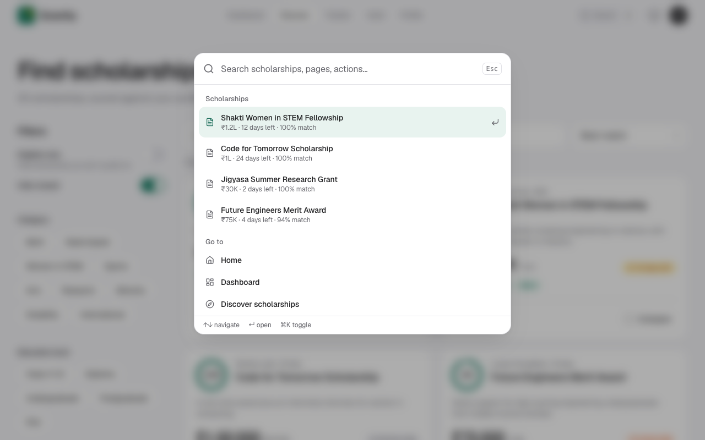

## Design & motion

The look is deliberately quiet: neutral greys, one emerald accent, one typeface (Geist), pill controls and soft surfaces. There is no gradient text, no glow and no stock illustration. Motion is there to explain what is happening, not to decorate.

**The landing page is a live surface, not a brochure.** It was planned and built with the [scroll-craft](https://github.com/nateherkai/scroll-craft) method: a written brief, a feeling curve with one engineered peak, a different scroll device for each beat, and verification frame by frame. The plan is in [`docs/scrollcraft/builds/grantly-landing/BRIEF.md`](docs/scrollcraft/builds/grantly-landing/BRIEF.md). Every panel on the page is real product markup computing from the clearly labelled sample student. Nothing is a painted mock-up.

| Section                  | Motion                   | What it shows                                                                                                                                                               |
| ------------------------ | ------------------------ | --------------------------------------------------------------------------------------------------------------------------------------------------------------------------- |
| Hero                     | parallax + pointer tilt  | Three real panels at different depths; the front card leans toward the cursor                                                                                               |
| The problem → the answer | none, deliberately       | Three short lines name the mess; the four pain points map to Grantly's answers                                                                                              |
| Finding                  | snap-scrolling rail      | The sample student's 12 real matches, sorted by fit (buttons, keyboard and swipe)                                                                                           |
| Understanding            | rules tick in on arrival | `getMatch()` checks each rule in plain words; the score ring fills to 94                                                                                                    |
| Applying                 | clip-path wipe           | The "4 of 6 ready" document list wipes into "6 of 6"                                                                                                                        |
| Tracking                 | none                     | The student's real tracker rows with urgency chips                                                                                                                          |
| **Signature**            | pinned, scroll-driven    | **Season scrubber:** scroll plays a season through the real `computeFunding()`. Statuses advance, the bar fills, and the gap counts down to ₹0. Scrolling back reverses it. |
| Close                    | a real form              | Level and marks give a live count of open scholarships; **Continue** carries both into onboarding                                                                           |

**Progressive enhancement.** Every section renders in its finished state by default: what crawlers, full-page screenshots, the pre-rendered HTML and reduced-motion users see. Animations only play for a visitor who actually scrolls toward a section, and they play once.

Implementation notes. The scroll engine is mounted on the landing subtree and destroyed on route change, and the bespoke acts read the same scroll progress through Framer Motion. Bars move with `transform` only (never `width`). UI transitions stay under 300ms on one ease-out curve. Under reduced motion, every position change is dropped: content fades in place instead of moving. App-wide, the nav, tab and segmented-control indicators glide between options with spring physics.

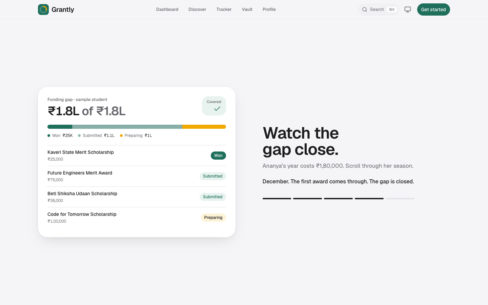

## Screenshots

| Discover                                                                            | Scholarship detail                                                                                         |
| ----------------------------------------------------------------------------------- | ---------------------------------------------------------------------------------------------------------- |
| 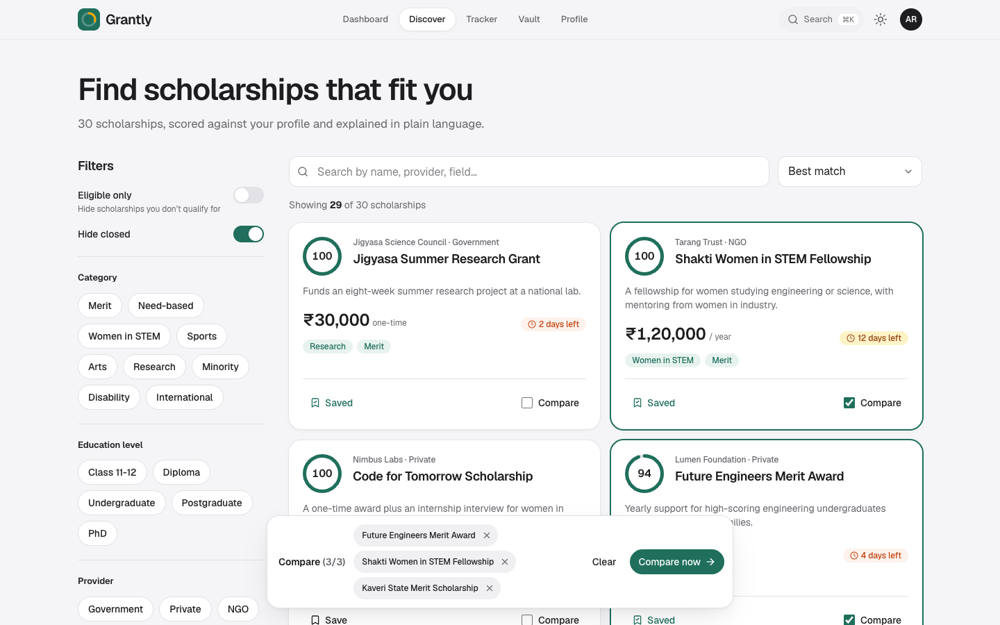 | 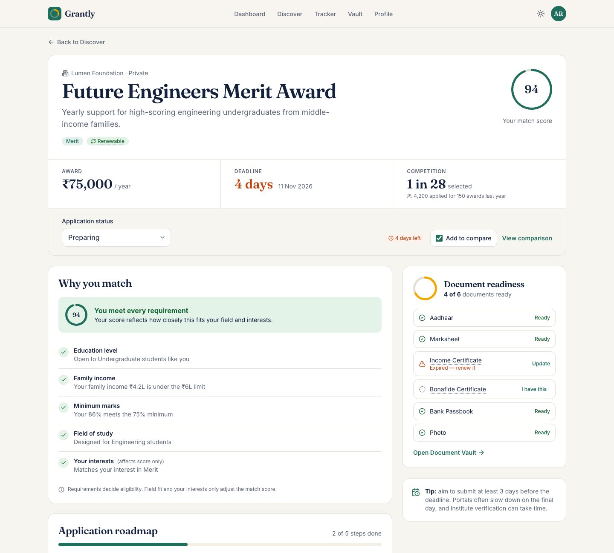 |
| **Tracker**                                                                         | **Compare**                                                                                                |
| 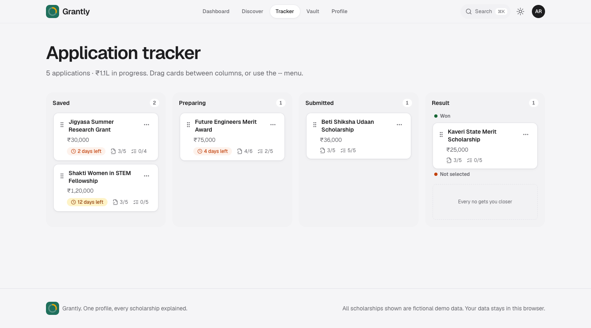                               | 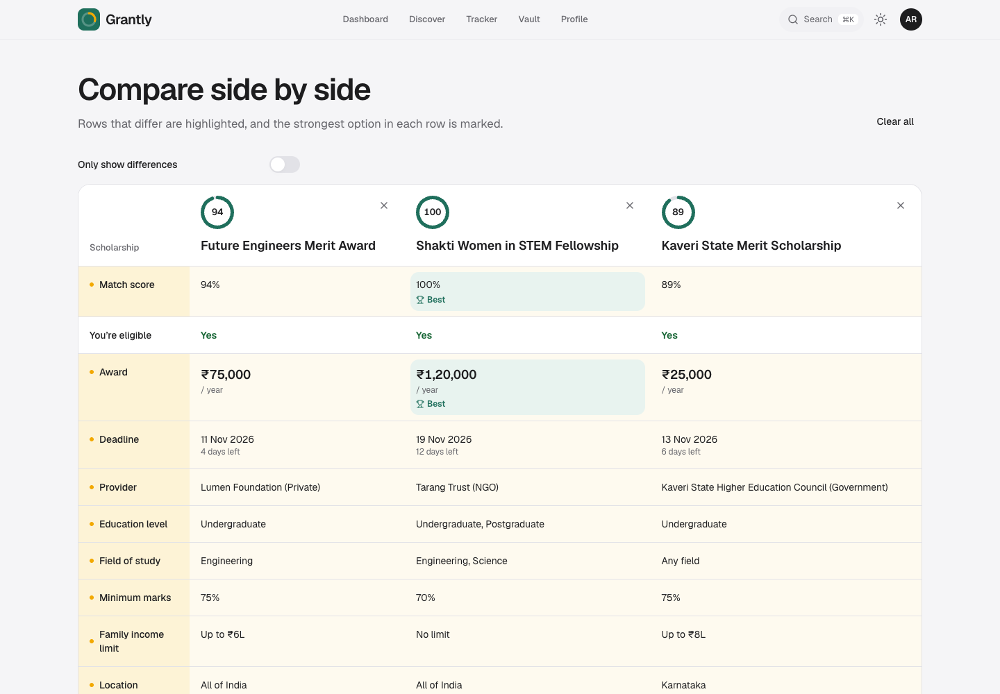                                             |
| **Onboarding reveal**                                                               | **Dark mode**                                                                                              |
| 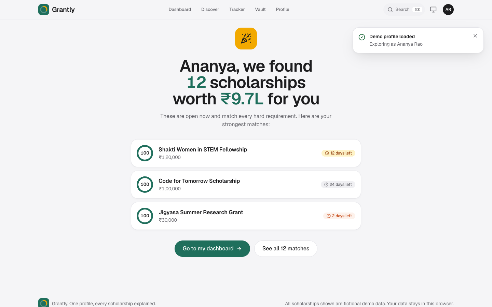        | 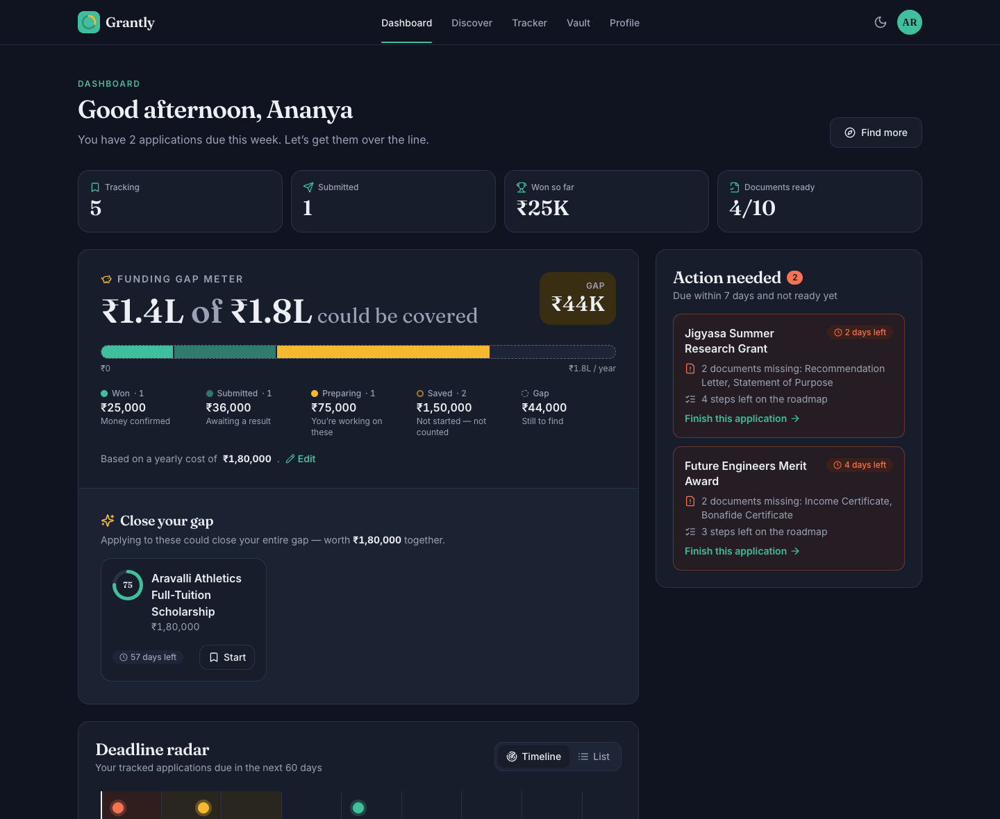                                             |

<p align="center">
  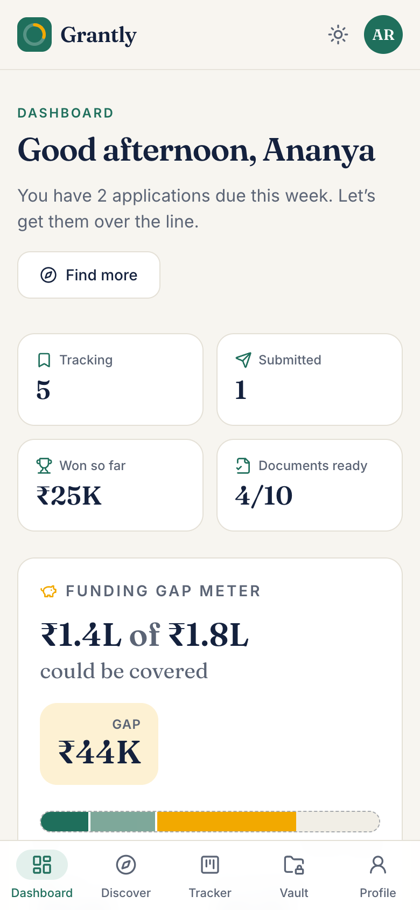
  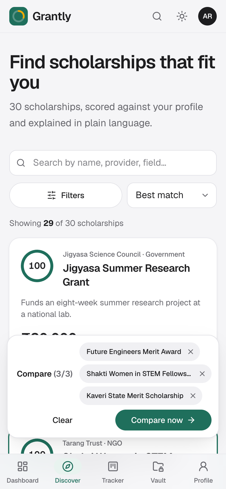
  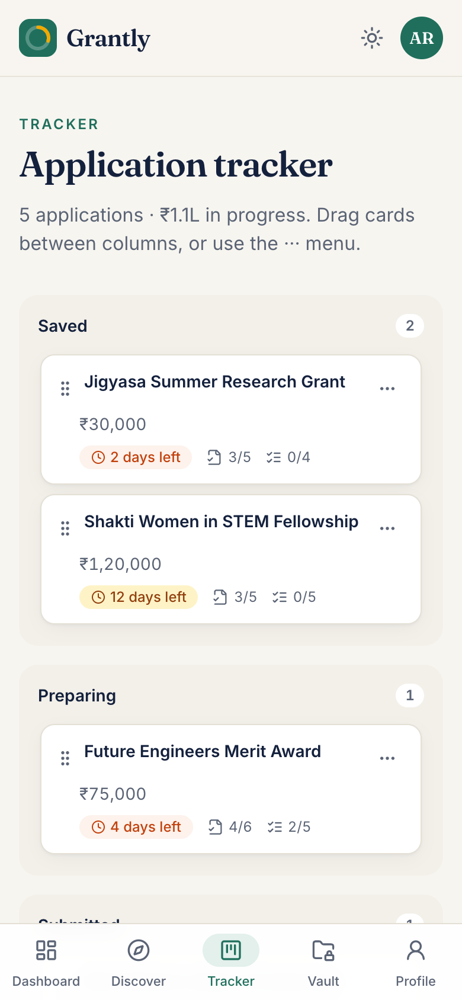
</p>

## Accessibility & responsiveness

Accessibility was tested, not assumed:

- **0 axe-core violations** (WCAG 2.1 A/AA + best practices) on all 10 routes, in **both light and dark themes**. Every colour pair meets AA contrast.
- **Keyboard-complete.** A skip link, visible focus rings, and focus moved to new content on route and wizard-step changes. Dialogs and the bottom sheet use the native `<dialog>`, so focus is trapped and Escape works without extra code.
- **Drag-and-drop without a mouse.** On the Tracker, Space picks a card up, the arrow keys **jump between columns**, and Space drops it. Custom screen-reader announcements describe each move ("Picked up X from Saved… moved to Preparing"). Every card also has a WAI-ARIA **"Move to…" menu** that returns focus to the card after it moves.
- **Text alternatives for visuals.** Match rings read "87% match", the funding bar has a full-sentence description, and roadmap progress is a labelled `progressbar`.
- **Accessible forms.** Labels, `aria-describedby` hints and errors, `aria-invalid`, and focus jumps to the first invalid field. Results counts and toasts are announced through `aria-live` regions.
- **Reduced motion.** `prefers-reduced-motion` turns off non-essential animation, both through Framer Motion's `MotionConfig` and a CSS fallback.
- **Responsive.** Verified with no horizontal overflow at **360, 768, 1280 and 1536px**. The mobile layout has a bottom tab bar, a filter bottom sheet and a stacked tracker, and respects the safe area.

## Tech stack

|             | Choice                                                                                                    | Why                                                                                     |
| ----------- | --------------------------------------------------------------------------------------------------------- | --------------------------------------------------------------------------------------- |
| Framework   | **React 18 + TypeScript (strict)** on **Vite**                                                            | Fast dev loop, strict types across data, logic and UI                                   |
| Styling     | **Tailwind CSS** with **CSS-variable design tokens**                                                      | One token set drives both themes and still supports opacity modifiers (`bg-primary/10`) |
| Routing     | **React Router v6**                                                                                       | Every route is `React.lazy` code-split behind a skeleton fallback                       |
| State       | **Zustand** + `persist` → `localStorage`                                                                  | Tiny, no boilerplate; the profile, tracker, vault and progress survive reloads          |
| Motion      | **Framer Motion** + the **scrollcraft** engine (vendored, MIT)                                            | Spring indicators, count-ups and bars in the app; scroll devices on the landing page    |
| Type        | **Geist**                                                                                                 | One neutral, precise family for display and text                                        |
| Drag & drop | **@dnd-kit/core**                                                                                         | Accessible by design, with pointer, touch and keyboard sensors                          |
| Search      | **Fuse.js**                                                                                               | Weighted fuzzy search across names, providers, categories and fields                    |
| Dates       | **date-fns**                                                                                              | Calendar-day deadline maths                                                             |
| Icons       | **lucide-react**                                                                                          | Consistent icon set, no emoji used as icons                                             |
| Quality     | **Vitest** + **Testing Library**, **ESLint** (typescript-eslint, react-hooks, **jsx-a11y**), **Prettier** | 73 tests (logic + component); lint must pass                                            |

No UI kit. Every primitive (Button, Card, Badge, Chip, Input/Select, Dialog/Sheet, Tabs, Menu, Switch, ProgressRing, CommandPalette, Tooltip, EmptyState, Skeleton, CountUp, Toaster) is built from scratch with Tailwind.

## Architecture

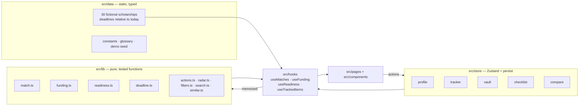

**Key decisions**

- **All business logic is pure.** `lib/` has no React and no side effects, and takes `now` as a parameter, so matching, funding, readiness, deadlines, filtering and action detection are deterministic and unit-tested.
- **Derived data is never stored.** The store holds only facts the user entered (profile, statuses, documents, ticked steps). Match scores, readiness, the funding gap and suggestions are computed in memoised hooks, so they can't go stale. Tick a document in the Vault and every readiness panel, the Compare table, Action needed and the Tracker update at once.
- **The data stays current.** Deadlines are computed relative to `new Date()` when the module loads, so there are always a few closing this week whenever the demo is opened.
- **Native platform first.** `<dialog>` handles modals and sheets, native radios and selects handle choices, and real `<table>` semantics are used for Compare.

### How the Match Score works (`src/lib/match.ts`)

| Criterion                                                             | Type     | Effect                                                           |
| --------------------------------------------------------------------- | -------- | ---------------------------------------------------------------- |
| Education level, income cap, minimum marks, gender, state             | **Hard** | Any failure means not eligible                                   |
| Field of study (when the scholarship is restricted to certain fields) | **Hard** | Same as above                                                    |
| Field of study (open-to-all scholarships)                             | Soft     | Fit bonus; an exact field match scores higher than "open to all" |
| Overlap with the student's interests                                  | Soft     | Ranks eligible options                                           |

`score = 60 × (hard criteria met ÷ total) + 20 × field fit + 20 × interest overlap`.
Ineligible scholarships are scaled down and capped at 35, so they always rank below eligible ones while near-misses still rank above poor fits.
Each criterion returns a plain-English `detail` string that the UI shows as written.

## Project structure

```
src/
├── components/
│   ├── ui/            # Hand-built primitives (Button, Dialog, Tabs, Menu, ProgressRing, …)
│   ├── layout/        # App shell, top nav, mobile tab bar, page header
│   ├── scholarship/   # Card, MatchRing, WhyYouMatch, Roadmap, DocumentReadiness, …
│   ├── dashboard/     # FundingGapMeter, DeadlineRadar, ActionNeeded
│   ├── discover/      # FilterPanel
│   ├── onboarding/    # RevealPanel
│   └── tracker/       # Board config, TrackerCard
├── pages/             # One lazy-loaded file per route
├── store/             # app.ts (persisted data), ui.ts (theme), toast.ts
├── lib/               # Pure logic + *.test.ts
├── hooks/             # Memoised selectors over store + lib
├── data/              # Scholarships, step templates, constants, glossary, demo seed
└── types.ts           # Domain model
```

## Getting started

Requires **Node 18.18+**.

```bash
npm install
npm run dev          # http://localhost:5173
```

| Script            | What it does                                       |
| ----------------- | -------------------------------------------------- |
| `npm run dev`     | Start the dev server                               |
| `npm run build`   | Type-check and build for production into `dist/`   |
| `npm run preview` | Serve the production build locally                 |
| `npm test`        | Run all 73 tests (logic + component)               |
| `npm run lint`    | Run ESLint, including accessibility rules          |
| `npm run check`   | Typecheck + lint + test + build: the pre-push gate |

## Deployment

**Live:** https://aayushsinghthapa-cloud.github.io/grantly/

**GitHub Pages (current).** `.github/workflows/deploy.yml` runs typecheck, lint and tests on every push to `main`, builds with `GITHUB_PAGES=true` (Vite `base` and the router `basename` become `/grantly/`), then **pre-renders every route** with `scripts/prerender.mjs`: all 38 URLs are served as real HTML with HTTP 200, each with its own title, description and canonical link, plus `sitemap.xml` and `robots.txt`. React takes over in the browser. Run it locally with `npm run build:static`.

**Vercel (alternative), zero configuration:**

1. Push to GitHub, then go to **vercel.com → Add New → Project** and import the repo.
2. Vercel detects **Vite**. Keep the defaults: build command `npm run build`, output directory `dist`.
3. Deploy. `vercel.json` rewrites every path to `index.html`, so deep links such as `/scholarship/future-engineers-merit` work on refresh.

No environment variables or backend are needed.

## Data & privacy

- **All 30 scholarships are fictional.** Providers, amounts and rules were invented for this demo. They are not real organisations or real offers.
- **There is no backend.** Everything a student enters stays in their own browser's `localStorage`. **Profile → Reset all data** clears it.

## License

[MIT](LICENSE). Original work created for the THE OUTPOST hackathon.

The scroll engine in `src/vendor/scrollcraft/` is the open-source [scroll-craft](https://github.com/nateherkai/scroll-craft) runtime by Nate Herk, used unmodified under the MIT License (see `src/vendor/scrollcraft/LICENSE`).
