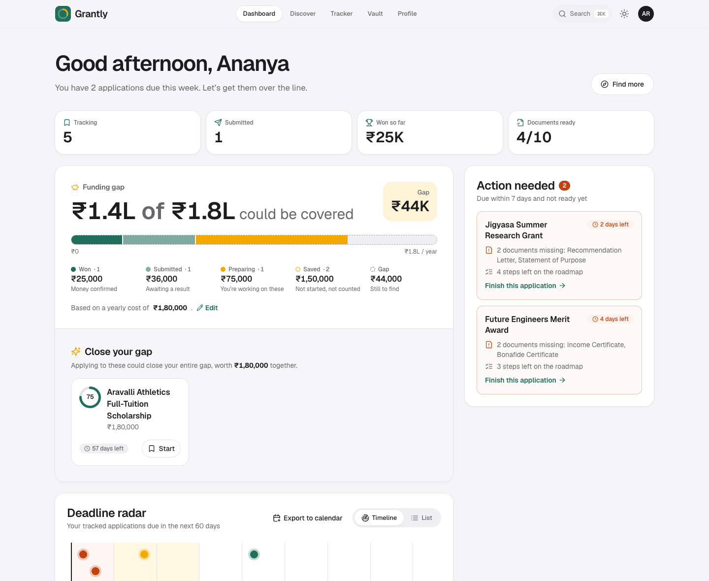
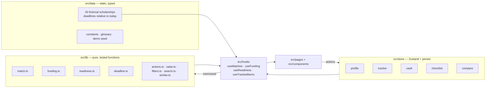

<div align="center">

# Grantly

### One profile. Every scholarship, explained.

A scholarship co-pilot that finds what you qualify for, explains why in plain language,<br/>
walks you through every application, and shows how much of your year is actually funded.

**[Live demo](https://REPLACE-WITH-VERCEL-URL)** · **[Source](https://github.com/REPLACE-WITH-REPO)** · Built for _THE OUTPOST_ by Frontend Arena



</div>

> **Judges — try it in 30 seconds:** open the live demo → **Find my scholarships** → **Try demo profile**.
> You'll land in a realistic state: one award won, one submitted, one due in 4 days with missing documents, and a funding gap to close.

---

## The problem

Students who need scholarships the most face four compounding problems:

1. **Finding** — opportunities are scattered across government portals, NGOs, companies and universities.
2. **Understanding** — eligibility rules are dense ("merit-cum-means", "bonafide", "income ceiling") and it's unclear whether _you_ qualify.
3. **Applying** — every application has its own steps and its own list of documents, many of which expire.
4. **Tracking** — deadlines, statuses and documents end up spread across notes, inboxes and memory.

## The idea

**Fill in one eligibility profile, once — and everything personalises to it.**
Every scholarship gets a match score with a rule-by-rule explanation; every application gets a roadmap and a document checklist
fed by one shared vault; and a single meter shows how much of your real yearly cost your applications could cover.

## Features, mapped to the brief

| Pain point        | What Grantly does                                                                                                                                                                                                                               | Where                          |
| ----------------- | ----------------------------------------------------------------------------------------------------------------------------------------------------------------------------------------------------------------------------------------------- | ------------------------------ |
| **Finding**       | **Smart Discover** — fuzzy search, 7 filters (category, level, provider, amount, deadline window, eligible-only, hide closed), 3 sorts, and a **Match Score ring** on every card                                                                | `/discover`                    |
| **Understanding** | **Why you match** — every hard rule ✓/✗ with a plain-English reason (_"Your family income ₹4.2L is under the ₹6L limit"_), side-by-side **Compare** with differences highlighted and the best value marked, and **glossary tooltips** on jargon | `/scholarship/:id`, `/compare` |
| **Applying**      | **Application Roadmap** — an interactive, persisted step checklist per scholarship · **Document Readiness** — _"4 of 6 documents ready"_, computed live from the **Document Vault** (with expiry dates)                                         | `/scholarship/:id`, `/vault`   |
| **Tracking**      | **Tracker board** (Saved → Preparing → Submitted → Won / Not selected) with drag-and-drop _and_ a keyboard/menu alternative · **Deadline Radar** timeline · **Action needed** list                                                              | `/tracker`, `/dashboard`       |
| ✨ **Signature**  | **Funding Gap Meter** — enter your yearly cost; see what's won, pending and in progress as an animated stacked bar, the gap that remains, and the best-matched scholarships that would close it                                                 | `/dashboard`                   |

### The Funding Gap Meter

Most scholarship tools stop at "here are some scholarships". Grantly answers the question students actually have: **_is my year paid for?_**

- Sums tracked scholarships by status: **won** (confirmed), **submitted** (pending), **preparing** (in progress). Merely _saved_ items are shown but not counted.
- Shows the remaining **gap** against your real yearly cost (editable inline).
- Suggests a greedy set of **eligible, still-open, untracked** scholarships ranked by `match score × amount` that would close the gap — and one click on **Start** moves a suggestion into Preparing, updating the meter live.

### Extras

- **⌘K / Ctrl+K command palette** — jump to any scholarship (fuzzy search, with match score and days left), any page, or run actions (switch theme, export deadlines, load the demo). Implements the WAI-ARIA combobox pattern: focus stays in the input, arrows move `aria-activedescendant`, Enter runs, Escape closes and restores focus.
- **Calendar export (.ics)** — **Add to calendar** on any scholarship, or **Export to calendar** on the Deadline Radar for every tracked deadline. Each becomes an all-day event with a link back and a reminder 3 days before; works with Google, Apple and Outlook Calendar. The RFC 5545 output (text escaping, 75-octet line folding, CRLF) is unit-tested.


## Screenshots

| Discover                                                                            | Scholarship detail                                                                                         |
| ----------------------------------------------------------------------------------- | ---------------------------------------------------------------------------------------------------------- |
|  |  |
| **Tracker**                                                                         | **Compare**                                                                                                |
|                                |                                              |
| **Onboarding reveal**                                                               | **Dark mode**                                                                                              |
|         |                                              |

<p align="center">
  
  
  
</p>

## Accessibility & responsiveness

Accessibility was tested, not assumed:

- **0 axe-core violations** (WCAG 2.1 A/AA + best practices) on all 10 routes, in **both light and dark themes**. Every colour pair meets AA contrast.
- **Keyboard-complete.** A skip link, visible focus rings, and focus moved to new content on route and wizard-step changes. Dialogs and the bottom sheet use the native `<dialog>`, so focus is trapped and Escape works without extra code.
- **Drag-and-drop without a mouse.** On the Tracker, Space picks a card up, the arrow keys **jump between columns**, and Space drops it. Custom screen-reader announcements describe each move ("Picked up X from Saved… moved to Preparing"). Every card also has a WAI-ARIA **"Move to…" menu** that returns focus to the card after it moves.
- **Text alternatives for visuals.** Match rings read "87% match", the funding bar has a full-sentence description, and roadmap progress is a labelled `progressbar`.
- **Accessible forms.** Labels, `aria-describedby` hints and errors, `aria-invalid`, and focus jumps to the first invalid field. Results counts and toasts are announced through `aria-live` regions.
- **Reduced motion.** `prefers-reduced-motion` turns off non-essential animation, both through Framer Motion's `MotionConfig` and a CSS fallback.
- **Responsive.** Verified with no horizontal overflow at **360, 768, 1280 and 1536px**. The mobile layout has a bottom tab bar, a filter bottom sheet and a stacked tracker, and respects the safe area.

## Tech stack

|             | Choice                                                                              | Why                                                                                     |
| ----------- | ----------------------------------------------------------------------------------- | --------------------------------------------------------------------------------------- |
| Framework   | **React 18 + TypeScript (strict)** on **Vite**                                      | Fast dev loop, strict types across data, logic and UI                                   |
| Styling     | **Tailwind CSS** with **CSS-variable design tokens**                                | One token set drives both themes and still supports opacity modifiers (`bg-primary/10`) |
| Routing     | **React Router v6**                                                                 | Every route is `React.lazy` code-split behind a skeleton fallback                       |
| State       | **Zustand** + `persist` → `localStorage`                                            | Tiny, no boilerplate; the profile, tracker, vault and progress survive reloads          |
| Motion      | **Framer Motion**                                                                   | Reveal, count-ups, animated bars and rings, all respecting reduced motion               |
| Drag & drop | **@dnd-kit/core**                                                                   | Accessible by design, with pointer, touch and keyboard sensors                          |
| Search      | **Fuse.js**                                                                         | Weighted fuzzy search across names, providers, categories and fields                    |
| Dates       | **date-fns**                                                                        | Calendar-day deadline maths                                                             |
| Icons       | **lucide-react**                                                                    | Consistent icon set, no emoji used as icons                                             |
| Quality     | **Vitest**, **ESLint** (typescript-eslint, react-hooks, **jsx-a11y**), **Prettier** | 59 unit tests; lint must pass with zero errors                                          |

No UI kit. Every primitive (Button, Card, Badge, Chip, Input/Select, Dialog/Sheet, Tabs, Menu, Switch, ProgressRing, CommandPalette, Tooltip, EmptyState, Skeleton, CountUp, Toaster) is built from scratch with Tailwind.

## Architecture



**Key decisions**

- **All business logic is pure.** `lib/` has no React and no side effects, and takes `now` as a parameter, so matching, funding, readiness, deadlines, filtering and action detection are deterministic and unit-tested.
- **Derived data is never stored.** The store holds only facts the user entered (profile, statuses, documents, ticked steps). Match scores, readiness, the funding gap and suggestions are computed in memoised hooks, so they can't go stale. Tick a document in the Vault and every readiness panel, the Compare table, Action needed and the Tracker update at once.
- **The data stays current.** Deadlines are computed relative to `new Date()` when the module loads, so there are always a few closing this week whenever the demo is opened.
- **Native platform first.** `<dialog>` handles modals and sheets, native radios and selects handle choices, and real `<table>` semantics are used for Compare.

### How the Match Score works (`src/lib/match.ts`)

| Criterion                                                             | Type     | Effect                                                           |
| --------------------------------------------------------------------- | -------- | ---------------------------------------------------------------- |
| Education level, income cap, minimum marks, gender, state             | **Hard** | Any failure means not eligible                                   |
| Field of study (when the scholarship is restricted to certain fields) | **Hard** | Same as above                                                    |
| Field of study (open-to-all scholarships)                             | Soft     | Fit bonus; an exact field match scores higher than "open to all" |
| Overlap with the student's interests                                  | Soft     | Ranks eligible options                                           |

`score = 60 × (hard criteria met ÷ total) + 20 × field fit + 20 × interest overlap`.
Ineligible scholarships are scaled down and capped at 35, so they always rank below eligible ones while near-misses still rank above poor fits.
Each criterion returns a plain-English `detail` string that the UI shows as written.

## Project structure

```
src/
├── components/
│   ├── ui/            # Hand-built primitives (Button, Dialog, Tabs, Menu, ProgressRing, …)
│   ├── layout/        # App shell, top nav, mobile tab bar, page header
│   ├── scholarship/   # Card, MatchRing, WhyYouMatch, Roadmap, DocumentReadiness, …
│   ├── dashboard/     # FundingGapMeter, DeadlineRadar, ActionNeeded
│   ├── discover/      # FilterPanel
│   ├── onboarding/    # RevealPanel
│   └── tracker/       # Board config, TrackerCard
├── pages/             # One lazy-loaded file per route
├── store/             # app.ts (persisted data), ui.ts (theme), toast.ts
├── lib/               # Pure logic + *.test.ts
├── hooks/             # Memoised selectors over store + lib
├── data/              # Scholarships, step templates, constants, glossary, demo seed
└── types.ts           # Domain model
```

## Getting started

Requires **Node 18.18+**.

```bash
npm install
npm run dev          # http://localhost:5173
```

| Script            | What it does                                       |
| ----------------- | -------------------------------------------------- |
| `npm run dev`     | Start the dev server                               |
| `npm run build`   | Type-check and build for production into `dist/`   |
| `npm run preview` | Serve the production build locally                 |
| `npm test`        | Run the Vitest unit tests (59)                     |
| `npm run lint`    | Run ESLint, including accessibility rules          |
| `npm run check`   | Typecheck + lint + test + build: the pre-push gate |

## Deployment (Vercel)

The repo deploys with zero configuration:

1. Push to GitHub, then go to **vercel.com → Add New → Project** and import the repo.
2. Vercel detects **Vite**. Keep the defaults: build command `npm run build`, output directory `dist`.
3. Deploy. `vercel.json` rewrites every path to `index.html`, so deep links such as `/scholarship/future-engineers-merit` work on refresh.

No environment variables or backend are needed.

## Data & privacy

- **All 30 scholarships are fictional.** Providers, amounts and rules were invented for this demo. They are not real organisations or real offers.
- **There is no backend.** Everything a student enters stays in their own browser's `localStorage`. **Profile → Reset all data** clears it.

## License

Original work created for the THE OUTPOST hackathon.
